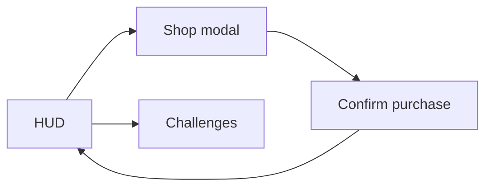

# Wireframes without a plugin

Excalidraw is lovely and optional. A UI sketch belongs in the note describing the feature, so it travels
with the decision instead of living in a `.excalidraw` file nobody opens.

## ASCII wireframe

```text
┌──────────────────────────────────────────────┐
│ [BACK]   SHOP                 [money: 1.2K]  │  header 64px
├──────────────────────────────────────────────┤
│ ┌────────┐ ┌────────┐ ┌────────┐ ┌────────┐  │
│ │ item   │ │ item   │ │ item   │ │ item   │  │ card 160×160
│ │ 120 Kc │ │ 300 Kc │ │ LOCKED │ │ 90 Kc  │  │
│ └────────┘ └────────┘ └────────┘ └────────┘  │
│                                              │
│  ── 2-column on phone, 4-column on desktop ──│
├──────────────────────────────────────────────┤
│ [Buy]  [Equip]              [info tooltip]   │  footer 72px
└──────────────────────────────────────────────┘
```

## Mermaid (navigable, harmless)



Mermaid renders on GitHub and in many viewers; Obsidian needs core support or a plugin, so **treat it as
decoration**, never the only copy of information.

## The checklist a wireframe must answer

- [ ] What is the primary action, and is it the most prominent thing?
- [ ] Where does the money/score live, and is it visible while spending?
- [ ] What happens at 375 px wide (phone portrait)?
- [ ] What is the empty state ("nothing here")?
- [ ] What is the error state (insufficient funds / locked)?
- [ ] Where does focus go on open (controller)?

## Rules

- One wireframe per note, updated when the UI changes — a stale wireframe is worse than none.
- No screenshots of someone else's game as a spec ([[R-content-and-ownership]]).
- Numbers in the sketch are real (sizes in px), so the implementation can follow it.

