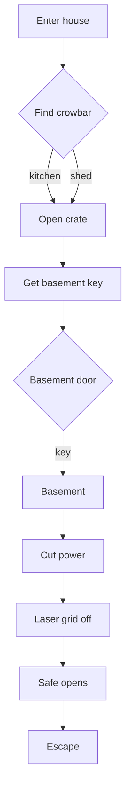

# Puzzle dependency graph

The graph is the level's logic; draw it before you build.



## Rules

1. **Every node has ≥ 1 incoming and ≥ 1 outgoing** except start and end.
2. **No node requires two mutually exclusive inputs** (unless the level is explicitly a choice).
3. **Every cycle has an exit** — a "come back later" loop is fine, a trap is not.
4. **Depth ≤ 5 steps of insight** for a 20-minute level; deeper feels like homework.
5. **Multiple solutions to the same node** is the cheapest way to reduce softlocks (two ways to get the
   crowbar).

## Checking solvability mechanically

Model the graph as data and run a traversal from the start state:

```lua
-- Untested: exhaustive reachability check over item sets
local function reachable(items, graph)
    local have = table.clone(items)
    local changed = true
    while changed do
        changed = false
        for _, edge in graph.edges do
            if edge.requires(have) and not have[edge.gives] then
                have[edge.gives] = true
                changed = true
            end
        end
    end
    return have
end
```

Run it for every possible starting subset in a test — that is how you prove there is no dead end rather
than hoping a playtester finds one.

