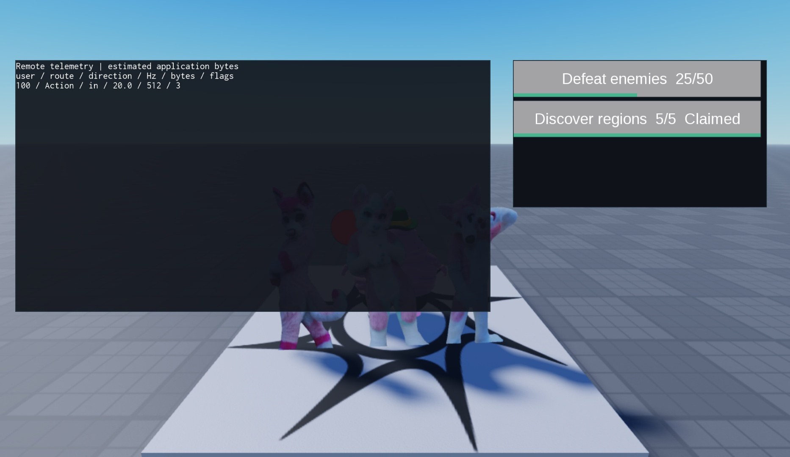

# Backend systems test evidence — v1.0.0

Tested on 2026-11-02 in a connected Roblox Studio session, version 0.745.0.7451137. Studio started in Edit. Tests ran in Play and the session was returned to Edit afterward. No production place scripts existed in the initial script inventory; existing scene content was preserved.

## Server result

The final run returned `{"run":11,"failed":0,"passed":11}`. One test case runs 34 economy fault assertions; the other cases cover module loading and runtime behavior. The mock store deliberately reruns each transform against the same prior value and can fail before a write or after committing it.

Tested: verbatim relevant final console lines.

```text
Backend fault harness: 34 checks passed (mock services only)
[PASS] durable economy interruption scenarios
[PASS] all backend modules load
[PASS] account writes commit in FIFO enqueue order
[PASS] component survives grace and is reported once
[PASS] remote burst drops third request and forget clears player
[PASS] remote cyclic payload fails closed
[PASS] rolling replay overwrites oldest and detaches clip
[PASS] room phases reject repeated finish and clean map once
[PASS] room capacity and membership gates
[PASS] proximity hysteresis and tag cleanup
[PASS] quest view updates rows and removes stale entries
[SUMMARY] 11 run, 11 passed, 0 failed
```

### Economy scenarios

Currency and unique-item gifting; interrupted recipient writes; successful credit with a lost response; retry and acknowledgment; insufficient funds; conflicting transfer IDs; missing item ownership; duplicate receipts; repeated transforms; an ambiguous receipt commit; unknown products; UTC midnight and missed days; cumulative playtime checkpoint deduplication; duplicate tier claims; event end exclusivity; repeated/out-of-order quest events; duplicate completion claims; detached shadows; missing inventory; sticky locks; unknown schema preservation; and bounded history rejection.

The mock store is local memory, not a real DataStore. Receipt player lookup is injected; ProcessReceipt is called directly without installing a live purchase callback. Hint services are omitted in the harness. The tests do not assert real service availability or cross-server durability.

### Runtime scenarios

The 19 ModuleScripts in the test Modules folder all loaded; the twentieth source file was the executing runner at UnitTest.RunUnitTest. Public-contract checks covered profiler grace/one-shot reports, a fake inbound remote's burst/refill/cyclic rejection and outbound observation, replay ring rollover/detachment, room phase/finish/map cleanup, capacity/membership, tagged culler hysteresis, and progress view row reuse/removal.

The final added case held the first account write behind a BindableEvent, enqueued two more writes,
released the first and checked commit order 1,2,3 plus the resulting balance. The implementation uses
explicit FIFO tickets within each server, rather than depending on scheduler wake-up order.

## Client result and visual check

A separate Client execution returned:

Tested: actual client smoke result.

```json
{"replayChecks":4,"dashboardRows":1,"networkOrPersistenceCalls":0,"questRows":2,"gui":"visible for screenshot"}
```

The replay factory created a fresh anchored noncolliding ghost, checked its midpoint X position at 5 between 0 and 10, checked completion and confirmed Destroy removed the ghost. The scene was placed above gameplay and removed immediately.

The telemetry overlay rendered one synthetic row and the quest view rendered two rows (25/50 and 5/5 Claimed). The screenshot was inspected for readable text, separate panels and proportional bars at this desktop viewport. This is a desktop smoke preview, not a responsive/device certification.



## Failure found and corrected

The first broad module-load pass found a missing closing `end` in the webhook factory. The nine initial behavioral cases passed independently, so the module-load check was promoted to an explicit tenth case before final verification. The adapter was corrected, the Play session restarted, and the suite passed. The final server run also includes the later unique-item transfer cases (34 fault assertions, versus the original 29).

A final review identified that serialized writes did not explicitly promise FIFO ordering. Added FIFO
tickets and an eleventh contention case, restarted Play and reran the full suite: 11 passed.

Unrelated pre-existing plugin warnings about unavailable loadstring / script-injection permission appeared in the console. No plugin permission or settings were changed; test modules were created through the authorized Studio tool and ran successfully.

## Cleanup evidence

The client preview and replay scene were destroyed. After stopping Play, a guarded cleanup removed exactly three owned temporary roots: ServerStorage.UnitTest, ReplicatedStorage.VaultBackendClientTest and ServerScriptService.UnitTestRunner.

Tested: actual cleanup result.

```json
{"unitTestRemaining":false,"runnerRemaining":false,"removedTemporaryRoots":3,"clientTestRemaining":false}
```

The tool only deleted roots carrying the VaultBackendTemporary attribute it had created. No place save, publish, paid action, persistent store request, webhook delivery or plugin installation was performed. Source headers were updated afterward to describe this evidence; those edits change comments only.

The later FIFO test reused a fresh server-only temporary setup. Its final cleanup returned
`{"runnerRemaining":false,"unitTestRemaining":false,"removedFinalTemporaryRoots":2}`.
The earlier client test root remained absent. The executable FIFO revision was included in the final run.

## Still untested

| Area | What remains |
|---|---|
| Account store | Actual DataStore persistence, metadata handling under live API faults, budgets and concurrent servers |
| Gift ledger | Messaging/MemoryStore paths, durable offline discovery, cross-server workers, archival and real contention |
| Guard/webhook | All autosave/release/shutdown integrations, real request delivery and durable backup recovery |
| Leak profiler | Actual GC collection and retaining-path investigation |
| Telemetry | Real RemoteEvent traffic, admin authorization, exact network measurements |
| Replay | Real animation assets, discontinuities, transport chunking, camera ownership and mobile load |
| Rooms | Stale yielding loaders/timeouts, real maps, spectators, multiplayer and teleport allocation |
| Proximity | Real streaming churn, effect routing and measured device savings |
| Retention | Long-running checkpoint recovery, clock operations and claim-history migration |
| Purchases | Actual callback installation, real purchases, gamepass ownership/refunds and live retry scheduling |
| Quests | Durable source events, remote claim authorization, recurring/versioned migration and pagination |

These gaps are tracked in [[ISSUES]]. Scoped `tested_studio` does not imply all branches or integrations were exercised.
