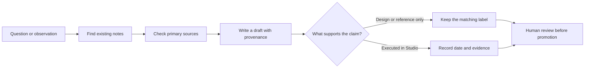
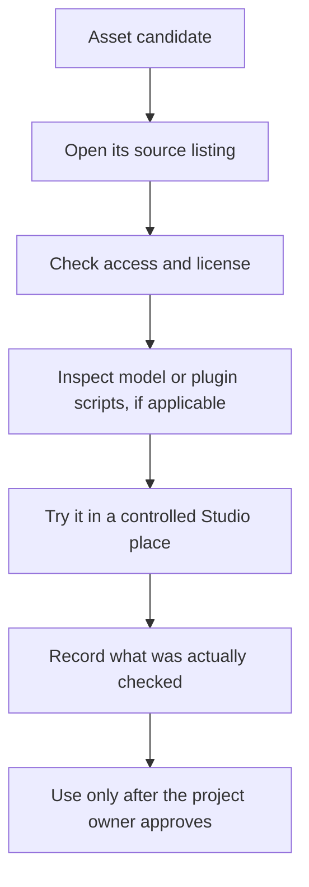

# Kaffeins Roblox Development Vault

A working reference library for Roblox developers. It brings together engineering notes, reusable system designs, game design material, and a local search tool. The notes help you find a useful starting point and the sources behind it; they are not a substitute for checking current Roblox behavior in Studio.

The vault is Markdown first. Open it in Obsidian for backlinks and maps, or read it in any editor.

> **License:** the vault uses the [CC0 1.0 Universal dedication](https://creativecommons.org/publicdomain/zero/1.0/). It applies only to material the maintainer owns or is authorized to dedicate. Roblox assets, marks, and rights not held by the maintainer are not covered. See [CREDITS.md](CREDITS.md) for source attribution and [RELEASE_CHECKLIST.md](RELEASE_CHECKLIST.md) for release details.

## What’s inside

- Roblox engineering references and server-authority checklists
- Reusable mechanics and system designs
- Horror, enemy AI, UI, level design, and progression notes
- A research catalogue of 209 asset candidates, with source and verification fields
- A Python command-line tool for searching notes, building an index, and exporting records
- Templates and working guidance for documenting new research

The content report counts 490 notes; the validator separately checks notes and excludes eight test fixtures. The 206 imported asset records are preserved alongside three separately researched candidates. None of the candidates has been verified in Studio.

## Start here

1. Open this folder as a vault in Obsidian, or open [HOME.md](HOME.md) in a Markdown viewer.
2. Follow the maps from [HOME.md](HOME.md) to the subject you need.
3. Before relying on a technical note, check its source, date, confidence, and verification label.
4. For asset candidates, read the record and verify access, license, and behavior yourself before use.

## Search from a terminal

Python 3.11 or newer is needed for the search tool. It uses the standard library; no package installs are required. Run commands from the folder that contains `scripts/`.

```sh
python scripts/gamedev_kb.py doctor
python scripts/gamedev_kb.py validate
python scripts/gamedev_kb.py index
python scripts/gamedev_kb.py search "server authoritative pickup" --limit 10
python scripts/gamedev_kb.py context "door interaction" --budget 6000
```

On Windows, use `py -3` if `python` is not on PATH. For command details and filters:

```sh
python scripts/gamedev_kb.py search --help
python scripts/gamedev_kb.py context --help
```

The index is a local cache at `config/index.sqlite`; `index` rebuilds it. Search has a pure-Python fallback when SQLite FTS5 is unavailable. Browsing the notes does not require Python.

## How the notes are meant to flow

A note should keep its source and confidence visible. New material starts as a draft; only a human review or a recorded test should move it further.



The asset catalogue follows the same rule: a listing or ID is a lead, not permission to use an asset.



## Contributing

Contributions are welcome as focused changes that make a note easier to verify or reuse. Start with [AGENTS.md](AGENTS.md), [SCHEMA.md](SCHEMA.md), and the map for the section you plan to edit. Search the vault before adding a note so existing work can be corrected or extended instead of duplicated.

1. Make the smallest useful edit and keep it inside the vault.
2. Give every new note valid frontmatter and a unique ID, following [SCHEMA.md](SCHEMA.md).
3. Include source links and access dates for factual claims. If a detail is unconfirmed, say so and lower the confidence.
4. Label code blocks `Tested:`, `Untested:`, or `Pseudocode:`. Studio testing needs a date and evidence path.
5. Keep asset access, safety, and license fields at `unknown` unless they were actually checked.
6. Update the relevant map, [CHANGELOG.md](CHANGELOG.md), and [ISSUES.md](ISSUES.md) when appropriate.
7. From the vault root, run the checks below and include their real output in your pull request.

```sh
python scripts/gamedev_kb.py validate
python scripts/gamedev_kb.py index
python -m unittest discover -s tests -v
```

Please don’t include credentials, private place data, copied asset files, or personal information. Don’t mark a note reviewed or tested based only on inspection. A pull request is a proposal; maintainers decide whether and how a claim is promoted.

## Folder map

```text
00 - Start Here/       entry points and maps
01 - Asset Library/    candidate records and indexes
02 - Roblox Development/engineering references
03 - Reusable Systems/ mechanics and system designs
04 - Horror Design/    pacing, tension, and atmosphere
05 - Enemy AI/         behavior and decision systems
06 - UI UX and Game Feel/
07 - Level Design and Progression/
08 - Bugs and Solutions/
09 - AI Agent Knowledge/
10 - Projects and Experiments/
11 - Templates and Schemas/
12 - Reference Sources/
13 - Dashboards/
imports/raw/            preserved source research and hash manifest
scripts/                search, validation, import, and map tools
tests/                  standard-library tests and fixtures
config/                 vault settings and regenerated search index
```

## Evidence and limitations

This is a research and design library, not a Roblox game project. No recipes in this vault have been tested in Studio. Roblox APIs and platform behavior change; check current Creator Hub documentation and test changes in a controlled experience.

The 209 asset entries are candidates, not recommendations or grants of permission. Access, license, and safety may be unknown. The vault stores records and links rather than asset bytes, but redistribution of research records still requires a rights review.

Some reusable system notes were adapted from a separate experience and have not been tested in this vault. Their provenance is recorded in the notes. Do not treat them as cleared for public redistribution until ownership and permission are reviewed.

## License and sources

The license is CC0 1.0, a public-domain dedication. It is intended to apply only to material the maintainer owns or is authorized to dedicate. Source references and the available attribution record are in [CREDITS.md](CREDITS.md); see [LICENSE](LICENSE) for the full dedication text.
